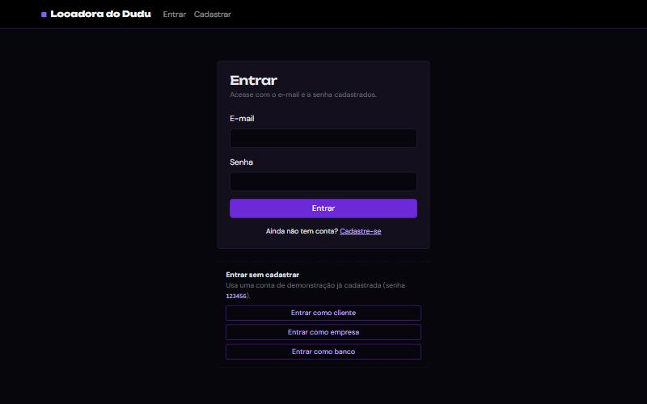
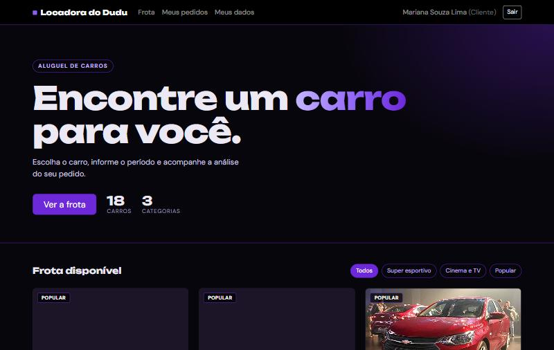
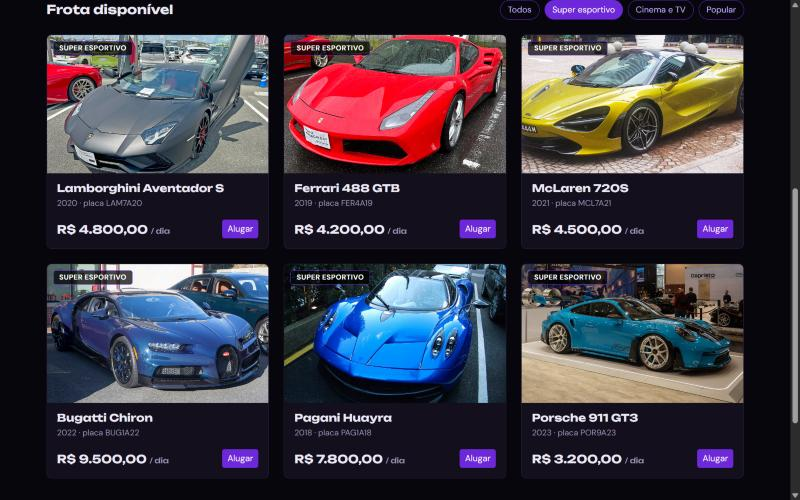
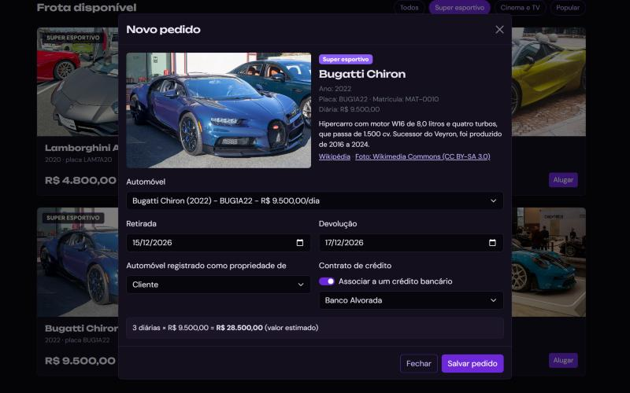
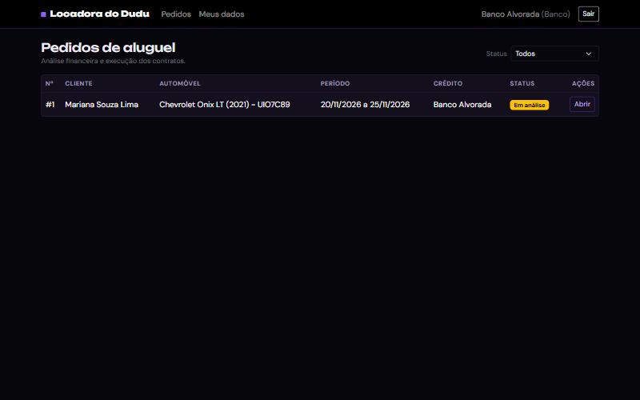
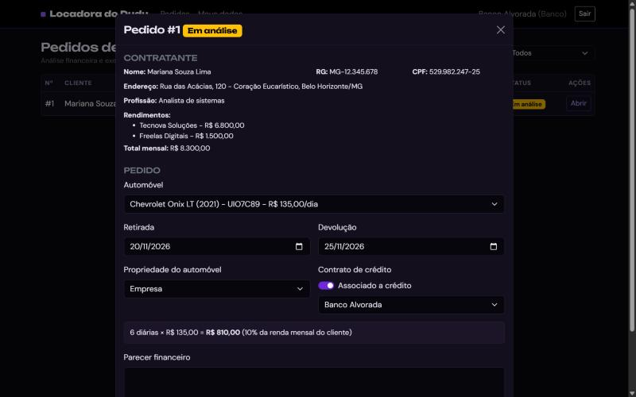

<!-- README baseado no template do Prof. Dr. João Paulo Aramuni (disciplina de Desenvolvimento de Interfaces Web) -->

---

# 🚗 Locadora do Dudu - Sistema de Aluguel de Carros 🚗

> [!NOTE]
> Sistema web para apoio à gestão de aluguéis de automóveis: o cliente faz, acompanha, modifica e cancela pedidos pela Internet, e empresas e bancos analisam o pedido e executam o contrato.

<table>
  <tr>
    <td width="800px">
      <div align="justify">
        O <b>Laboratório 02 de DIW</b> pede um sistema de aluguel de carros com <b>HTML5, CSS3 e JavaScript</b>, interface em <b>Bootstrap 5</b> e persistência em uma API REST simulada com <b>JSON Server</b>, consumida via <b>Fetch API</b>. O sistema só pode ser usado após o cadastro e tem dois perfis: o <i>cliente</i>, que solicita os aluguéis, e o <i>agente</i> (empresa ou banco), que avalia o pedido financeiramente e executa o contrato. Este repositório reúne o código, os modelos UML (casos de uso, histórias de usuário, classes, pacotes e componentes) e a revisão desses modelos em relação ao que foi implementado.
      </div>
    </td>
    <td>
      <div>
        
      </div>
    </td>
  </tr>
</table>

---

## 🚧 Status do Projeto

[](https://github.com/eduardoaugustofn/Laboratorio2_DIW_PUCMG)
[](#-licença)
[](https://github.com/eduardoaugustofn/Laboratorio2_DIW_PUCMG/commits/main)

    

---

## 📚 Índice
- [Links Úteis](#-links-úteis)
- [Sobre o Projeto](#-sobre-o-projeto)
- [Funcionalidades Principais](#-funcionalidades-principais)
- [Tecnologias Utilizadas](#-tecnologias-utilizadas)
- [Arquitetura](#-arquitetura)
- [Instalação e Execução](#-instalação-e-execução)
- [Deploy](#-deploy)
- [Estrutura de Pastas](#-estrutura-de-pastas)
- [Demonstração](#-demonstração)
- [Testes](#-testes)
- [Documentações utilizadas](#-documentações-utilizadas)
- [Autores](#-autores)
- [Contribuição](#-contribuição)
- [Agradecimentos](#-agradecimentos)
- [Licença](#-licença)

---

## 🔗 Links Úteis
* 🌐 **Demo Online:** [Acesse a Aplicação Web](https://eduardoaugustofn.github.io/Laboratorio2_DIW_PUCMG/)
  > 💻 **Descrição:** Aplicação publicada no GitHub Pages. Como o GitHub Pages só serve arquivos estáticos, ela roda no **modo local**: lê o `db.json` e guarda as alterações no `localStorage` do navegador.
* 📖 **Documentação de modelagem:** [pasta `docs`](docs/)
  > 📚 **Descrição:** Histórias de usuário, diagramas UML e a revisão dos modelos.
* 🔑 **Contas de demonstração:** a tela de login tem botões para entrar como cliente, empresa ou banco sem precisar se cadastrar. A senha das três contas é `123456`.

---

## 📝 Sobre o Projeto

**Por que existe:** é o Laboratório 02 da disciplina de Desenvolvimento de Interfaces Web (DIW), do curso de Engenharia de Software da PUC Minas. O enunciado descreve o sistema de uma locadora que recebe pedidos de aluguel pela Internet.

**Qual problema resolve:** centraliza em um só lugar o pedido do cliente e a análise financeira feita por empresas e bancos. O cliente não precisa ir à locadora, e o agente tem os dados do contratante e a renda total na mesma tela em que decide o pedido.

**Contexto:** projeto acadêmico. A API é simulada com JSON Server, então o sistema serve como protótipo e não como um produto em produção.

**Onde pode ser usado:** em uma locadora que queira receber pedidos online, e como exemplo de aplicação web sem framework, com Bootstrap e uma API REST.

A modelagem do sistema (casos de uso, histórias, classes, pacotes e componentes) está na pasta [`docs`](docs/), e a comparação entre o que o enunciado descreve e o que foi implementado está em [`docs/revisoes-dos-modelos.md`](docs/revisoes-dos-modelos.md).

---

## ✨ Funcionalidades Principais

- 🔐 **Cadastro e login com três perfis:** cliente, empresa e banco, com CPF validado e e-mail único.
- 🧑‍💼 **CRUD de cliente:** cadastro, consulta, alteração e exclusão da conta, com RG, CPF, endereço, profissão e até 3 empregadores com rendimento.
- 🚘 **Frota com fotos:** 18 carros em três categorias (populares, super esportivos e carros de filmes e séries), com filtro, descrição e valor da diária.
- 📝 **Pedidos de aluguel:** o cliente cria, consulta, modifica e cancela pedidos, com valor estimado calculado pelo período.
- 🏦 **Contrato de crédito opcional:** o pedido pode ser ligado a um banco, e o carro pode ser registrado em nome do cliente, da empresa ou do banco.
- ⚖️ **Análise financeira:** o agente vê os dados e a renda do cliente, escreve o parecer, aprova ou reprova e depois executa o contrato.
- 🛡️ **Regra de conflito de reservas:** o sistema recusa um pedido quando o carro já está reservado em parte do período.
- 💾 **Dois modos de dados:** JSON Server em `localhost` e `localStorage` quando não há servidor (GitHub Pages).

---

## 🛠 Tecnologias Utilizadas

### 💻 Front-end

* **Estrutura:** HTML5
* **Estilização:** CSS3 e [Bootstrap 5.3.3](https://getbootstrap.com/) (modo escuro), com tema próprio em roxo e preto
* **Linguagem:** JavaScript (ES2020, sem framework)
* **Fontes:** Unbounded e DM Sans (Google Fonts)
* **Comunicação com a API:** Fetch API

### 🖥️ Back-end (API simulada)

* **Runtime:** Node.js 18 ou superior
* **API REST:** [JSON Server 0.17.4](https://github.com/typicode/json-server)
* **Banco de dados:** arquivo `db.json`

### ⚙️ Infraestrutura

* **Hospedagem:** GitHub Pages
* **Servidor estático local:** `http-server`
* **Imagens dos carros:** Wikimedia Commons (licenças livres)

---

## 🏗 Arquitetura

O sistema roda inteiro no navegador e é dividido, como pede o enunciado, em dois subsistemas: a **gestão de pedidos e contratos** e a **construção dinâmica das páginas web**. As páginas HTML só têm a estrutura, e o JavaScript monta as tabelas, os cards e os modais a partir dos dados que busca na API.

Todo acesso a dados passa por um único arquivo, `js/api.js`, que oferece `listar`, `obter`, `criar`, `atualizar` e `excluir`. Ele escolhe sozinho o modo de funcionamento:

- **Modo servidor:** quando a página abre em `localhost` e o JSON Server responde na porta 3000, as chamadas vão para a API REST e ficam no `db.json`.
- **Modo local:** nos demais casos, os dados iniciais vêm do `db.json` e as alterações ficam no `localStorage`. As telas não percebem a diferença.

Decisões e limitações:

- Cliente, empresa e banco ficam na mesma coleção `usuarios`, diferenciados pelo campo `tipo`.
- O JSON Server não tem autenticação. As regras de perfil são aplicadas na interface, e a senha fica em texto puro no `db.json`. Isso é aceitável só em um protótipo de laboratório.
- No GitHub Pages, cada visitante vê apenas os próprios dados.

### Diagramas

| Diagrama | Descrição |
| :--- | :--- |
| [Casos de uso](docs/diagrama-de-casos-de-uso.md) | Atores, casos de uso e relações `include` e `extend`. |
| [Histórias de usuário](docs/historias-de-usuario.md) | 18 histórias com critérios de aceitação e o fluxo de status do pedido. |
| [Classes](docs/diagrama-de-classes.md) | Modelo de domínio e como ele aparece no `db.json` e no código. |
| [Pacotes](docs/diagrama-de-pacotes.md) | Visão lógica: pacotes da aplicação e do domínio. |
| [Componentes](docs/diagrama-de-componentes.md) | Componentes, interfaces REST e diagrama de sequência do pedido. |
| [Revisão dos modelos](docs/revisoes-dos-modelos.md) | Enunciado x implementação e modificações feitas. |

Os diagramas foram escritos em Mermaid e o GitHub os desenha direto nas páginas.

---

## 🔧 Instalação e Execução

### Pré-requisitos

* **Node.js:** versão 18 ou superior, que já traz o `npm`.
* Um navegador atual. As fontes, o Bootstrap e as fotos dos carros são carregados por CDN, então é preciso ter internet.

Não há variáveis de ambiente, banco de dados externo nem Docker neste projeto.

### 📦 Instalação de Dependências

```bash
git clone https://github.com/eduardoaugustofn/Laboratorio2_DIW_PUCMG.git
cd Laboratorio2_DIW_PUCMG
npm install
```

### ⚡ Como Executar a Aplicação

Use **dois terminais**.

#### Terminal 1: API (JSON Server)

```bash
npm run api
```

🚀 *A API fica disponível em **http://localhost:3000** (por exemplo, `/usuarios`, `/automoveis` e `/pedidos`). As alterações são gravadas no `db.json`.*

#### Terminal 2: Site

```bash
npm run site
```

🎨 *O site fica disponível em **http://localhost:8080**. Com a API ligada, ele usa o JSON Server automaticamente.*

> [!TIP]
> Se você abrir o site sem ligar a API, ele funciona no modo local, guardando os dados no navegador. Para voltar aos dados originais nesse modo, limpe os dados do site no navegador.

---

## 🚀 Deploy

O site é estático e está publicado no **GitHub Pages**, a partir da branch `main`.

1. No repositório, abra **Settings**, depois **Pages**.
2. Em **Build and deployment**, escolha **Deploy from a branch**, a branch `main` e a pasta `/ (root)`.
3. Salve. Em alguns minutos o site fica em `https://eduardoaugustofn.github.io/Laboratorio2_DIW_PUCMG/`.

Para publicar com o JSON Server de verdade seria preciso hospedar a API à parte (por exemplo no Render ou no Railway) e apontar a constante `API_URL` do `js/api.js` para ela.

---

## 📂 Estrutura de Pastas

```
.
├── index.html                   # 🔑 Login e entrada com contas de demonstração.
├── cadastro.html                # 🧑 Cadastro e "Meus dados" (CRUD de cliente).
├── cliente.html                 # 🚘 Frota, novo pedido e lista de pedidos do cliente.
├── agente.html                  # ⚖️ Lista e análise de pedidos (empresa e banco).
├── db.json                      # 💾 Dados iniciais: usuários, automóveis e pedidos.
├── package.json                 # 📦 Scripts para rodar a API e o site.
├── LICENSE                      # ⚖️ Licença Apache 2.0.
├── README.md                    # 📘 Documentação principal.
│
├── /css
│   └── style.css                # 🎨 Tema roxo e preto sobre o Bootstrap.
│
├── /js
│   ├── api.js                   # 🔌 Acesso a dados (JSON Server ou localStorage).
│   ├── common.js                # 🧰 Sessão, navbar e funções de apoio.
│   ├── pedidos.js               # 📏 Regras de pedido (período e conflito de reservas).
│   ├── cadastro.js              # 🧑 Tela de cadastro e dados do usuário.
│   ├── cliente.js               # 🚘 Tela do cliente.
│   └── agente.js                # ⚖️ Tela do agente.
│
└── /docs                        # 📐 Modelagem do sistema.
    ├── historias-de-usuario.md
    ├── diagrama-de-casos-de-uso.md
    ├── diagrama-de-classes.md
    ├── diagrama-de-pacotes.md
    ├── diagrama-de-componentes.md
    ├── revisoes-dos-modelos.md
    └── /img                     # 🖼️ Logo e capturas de tela.
```

---

## 🎬 Demonstração

### 🌐 Aplicação Web

| Tela | Captura de Tela |
| :---: | :---: |
| **Página de Login** | **Página inicial do cliente** |
|  |  |
| **Frota (filtro Super esportivo)** | **Novo pedido de aluguel** |
|  |  |
| **Lista de pedidos do agente** | **Análise financeira do pedido** |
|  |  |

### 💻 Exemplo de saída no Terminal (API)

Com `npm run api` rodando, a API responde as consultas do sistema. Exemplo com o pedido de demonstração:

```bash
curl http://localhost:3000/pedidos?clienteId=1
```

**Saída esperada:**
```json
[
  {
    "id": 1,
    "clienteId": 1,
    "automovelId": 3,
    "dataInicio": "2026-11-20",
    "dataFim": "2026-11-25",
    "propriedade": "empresa",
    "comCredito": true,
    "bancoId": 3,
    "status": "Em análise",
    "parecer": "",
    "criadoEm": "2026-11-02"
  }
]
```

---

## 🧪 Testes

O projeto não tem testes automatizados. A verificação foi feita manualmente, seguindo este roteiro:

| Cenário | Resultado esperado |
| :--- | :--- |
| Entrar com e-mail ou senha errados | Mensagem de erro e permanência no login. |
| Cadastrar cliente com CPF inválido | O cadastro é recusado. |
| Cadastrar com e-mail já existente | O cadastro é recusado. |
| Adicionar um 4º empregador | O botão de adicionar fica desabilitado. |
| Criar pedido com devolução antes da retirada | Mensagem de erro. |
| Criar dois pedidos do mesmo carro em datas sobrepostas | O segundo é recusado por conflito de reserva. |
| Cliente cancela pedido em análise | O status passa a "Cancelado" e o carro fica livre. |
| Agente aprova ou reprova sem parecer | Mensagem pedindo o parecer. |
| Agente aprova e depois executa o contrato | Status "Aprovado" e depois "Contrato executado". |
| Acessar `cliente.html` sem login | Redirecionamento para o login. |
| Cliente acessar `agente.html` | O sistema o devolve para a página do cliente. |

---

## 🔗 Documentações utilizadas

* 📖 **Interface:** [Documentação do Bootstrap 5](https://getbootstrap.com/docs/5.3/getting-started/introduction/)
* 📖 **API simulada:** [JSON Server](https://github.com/typicode/json-server/tree/v0.17.4)
* 📖 **Requisições HTTP:** [Fetch API (MDN)](https://developer.mozilla.org/pt-BR/docs/Web/API/Fetch_API)
* 📖 **Armazenamento no navegador:** [Web Storage API (MDN)](https://developer.mozilla.org/pt-BR/docs/Web/API/Web_Storage_API)
* 📖 **Diagramas:** [Mermaid](https://mermaid.js.org/intro/)
* 📖 **Fotos e textos dos carros:** [Wikimedia Commons](https://commons.wikimedia.org/) e [Wikipédia](https://pt.wikipedia.org/). Cada foto tem a licença e o link do arquivo no detalhe do carro, dentro da janela de pedido.
* 📖 **Padrão de commits:** [Conventional Commits](https://www.conventionalcommits.org/pt-br/v1.0.0/)

---

## 👥 Autores

| 👤 Nome | 🖼️ Foto | :octocat: GitHub |
|---------|----------|-----------------|
| Eduardo Augusto Freitas Nogueira | <div align="center"></div> | <div align="center"><a href="https://github.com/eduardoaugustofn">eduardoaugustofn</a></div> |

---

## 🤝 Contribuição

1. Faça um `fork` do projeto.
2. Crie uma branch para sua alteração (`git checkout -b feature/minha-feature`).
3. Faça o commit (`git commit -m 'feat: descrição da alteração'`), seguindo o [Conventional Commits](https://www.conventionalcommits.org/pt-br/v1.0.0/).
4. Envie a branch (`git push origin feature/minha-feature`).
5. Abra um **Pull Request**.

---

## 🙏 Agradecimentos

* [**Engenharia de Software PUC Minas**](https://www.instagram.com/engsoftwarepucminas/) - Pelo apoio institucional e pela estrutura acadêmica.
* [**Prof. Dr. João Paulo Aramuni**](https://github.com/joaopauloaramuni) - Pelo enunciado do laboratório, pelo template deste README e pelas aulas de Desenvolvimento de Interfaces Web.
* **Wikimedia Commons e seus fotógrafos** - Pelas fotos dos carros sob licenças livres.

---

## 📄 Licença

Este projeto é distribuído sob a **[Licença Apache 2.0](LICENSE)**.

---
