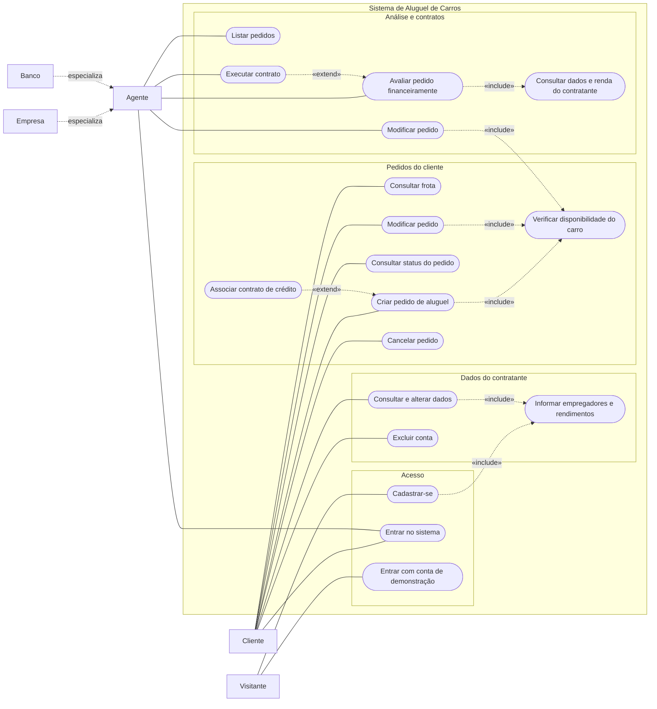

# Diagrama de Casos de Uso

O Mermaid não tem um tipo próprio para casos de uso, então o diagrama foi desenhado como fluxograma: os retângulos são os atores, as elipses são os casos de uso e as setas pontilhadas com `«include»` e `«extend»` são as relações entre casos de uso.

## Descrição dos principais casos de uso

| Caso de uso | Ator | Pré-condição | Resultado |
|-------------|------|--------------|-----------|
| Cadastrar-se | Visitante | Nenhuma | Conta criada e sessão iniciada. |
| Entrar no sistema | Cliente, Agente | Estar cadastrado | Sessão iniciada e redirecionamento para a página do perfil. |
| Criar pedido de aluguel | Cliente | Estar logado | Pedido salvo com status "Em análise". |
| Verificar disponibilidade do carro | (incluído) | Carro e período escolhidos | Recusa se houver pedido ativo sobreposto. |
| Associar contrato de crédito | Cliente | Criando ou editando um pedido | Pedido ligado a um banco. É opcional. |
| Cancelar pedido | Cliente | Pedido "Em análise" | Pedido passa a "Cancelado". |
| Avaliar pedido financeiramente | Agente | Pedido "Em análise" | Pedido passa a "Aprovado" ou "Reprovado", com parecer. |
| Executar contrato | Agente | Pedido "Aprovado" | Pedido passa a "Contrato executado". |

As histórias de usuário que detalham cada caso de uso estão em [historias-de-usuario.md](historias-de-usuario.md).
