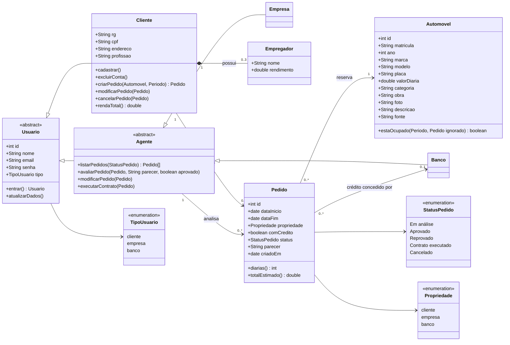

# Diagrama de Classes

Modelo de domínio do sistema, alinhado com o que existe no `db.json` e no código JavaScript.

## Como o modelo aparece no código

| Elemento do modelo | Onde está |
|--------------------|-----------|
| `Usuario`, `Cliente`, `Empresa`, `Banco`, `Empregador` | Coleção `usuarios` do `db.json`. Um único registro guarda o campo `tipo`. Os dados do cliente (`rg`, `cpf`, `endereco`, `profissao`) e a lista `empregadores` só existem nos usuários do tipo `cliente`. |
| `Automovel` | Coleção `automoveis`. |
| `Pedido` | Coleção `pedidos`. Guarda `clienteId`, `automovelId` e `bancoId` (quando há crédito). |
| `Propriedade` | Campo `propriedade` do pedido, pois o enunciado diz que o carro é registrado em nome do cliente, da empresa ou do banco **conforme o tipo de contrato**. |
| `Cliente.criarPedido`, `modificarPedido`, `cancelarPedido` | `js/cliente.js` |
| `Agente.avaliarPedido`, `modificarPedido`, `executarContrato` | `js/agente.js` |
| `Automovel.estaOcupado`, validação de período, `totalEstimado` | `js/pedidos.js` e `js/common.js` (`diarias`) |
| `Usuario.entrar` e sessão | `index.html` e `js/common.js` (`Sessao`) |
| `Cliente.cadastrar`, `atualizarDados`, `excluirConta`, `rendaTotal` | `js/cadastro.js` e `js/agente.js` (`rendaTotal`) |

O acesso aos dados de todas as classes passa por `js/api.js`.
