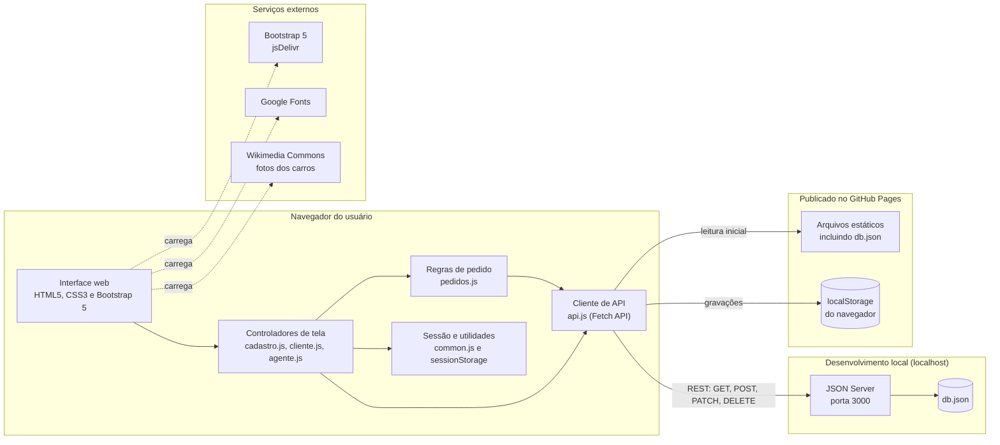
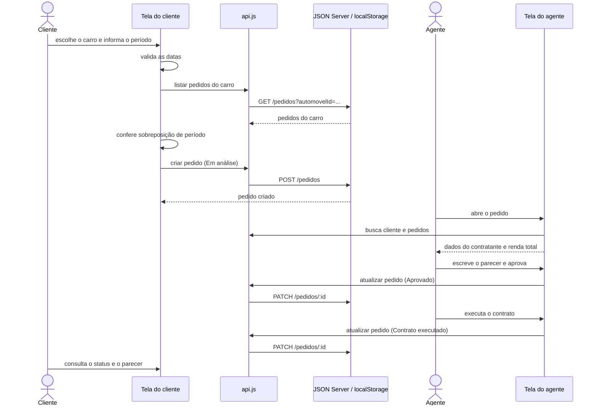

# Diagrama de Componentes

Visão de execução do sistema. Tudo roda no navegador do usuário, e o que muda entre os ambientes é o componente que guarda os dados.

## Interfaces

| Componente | Interface | Descrição |
|------------|-----------|-----------|
| JSON Server | `GET /usuarios?email=...` | Busca de usuário, usada no login e na checagem de e-mail repetido. |
| JSON Server | `GET /automoveis` | Lista da frota. |
| JSON Server | `GET /pedidos?clienteId=...`, `GET /pedidos?automovelId=...` | Pedidos de um cliente, e pedidos de um carro para checar conflito. |
| JSON Server | `POST /pedidos` | Criação de pedido. |
| JSON Server | `PATCH /pedidos/:id` | Modificação, cancelamento, avaliação e execução do contrato. |
| JSON Server | `POST /usuarios`, `PATCH /usuarios/:id`, `DELETE /usuarios/:id` | Cadastro, atualização e exclusão de conta. |
| Cliente de API | `listar`, `obter`, `criar`, `atualizar`, `excluir` | Interface única usada pelos controladores, igual nos dois modos. |

## Modos de dados

O `js/api.js` decide sozinho como guardar os dados:

- **Servidor:** quando a página abre em `localhost` e o JSON Server responde na porta 3000, todas as chamadas vão para a API REST e ficam gravadas no `db.json`.
- **Local:** em qualquer outro caso, como no GitHub Pages que só serve arquivos estáticos, os dados iniciais vêm do `db.json` e as alterações ficam no `localStorage` do navegador. Cada visitante vê só os próprios dados.

## Sequência: do pedido à execução do contrato

