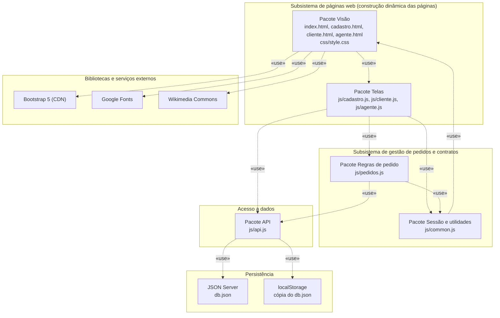
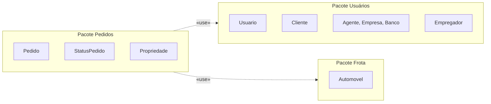

# Diagrama de Pacotes (Visão Lógica)

O enunciado divide o sistema em dois subsistemas: um para a **gestão de pedidos e contratos** e outro para a **construção dinâmica das páginas web**. O diagrama abaixo mostra os pacotes de cada subsistema e as dependências entre eles. As setas indicam `«use»`: o pacote de origem depende do de destino.

## Pacotes da aplicação

A seta de `Sessão e utilidades` para `Visão` existe porque o `js/common.js` monta a barra de navegação nas páginas.

## Pacotes do domínio

Organização lógica das classes do [diagrama de classes](diagrama-de-classes.md).

## Responsabilidade de cada pacote

| Pacote | Arquivos | Responsabilidade |
|--------|----------|------------------|
| Visão | `index.html`, `cadastro.html`, `cliente.html`, `agente.html`, `css/style.css` | Estrutura e aparência das páginas, com Bootstrap 5 e tema próprio. |
| Telas | `js/cadastro.js`, `js/cliente.js`, `js/agente.js` | Montam as páginas dinamicamente (tabelas, cards, modais) e tratam os eventos do usuário. |
| Regras de pedido | `js/pedidos.js` | Validação de período, checagem de carro ocupado e montagem das opções de carros e bancos. |
| Sessão e utilidades | `js/common.js` | Sessão do usuário, barra de navegação, formatação de datas e valores, escape de HTML e avisos. |
| API | `js/api.js` | Único ponto de acesso aos dados. Usa `fetch` no JSON Server ou o modo local. |
| Persistência | `db.json` e `localStorage` | Guardam usuários, automóveis e pedidos. |
