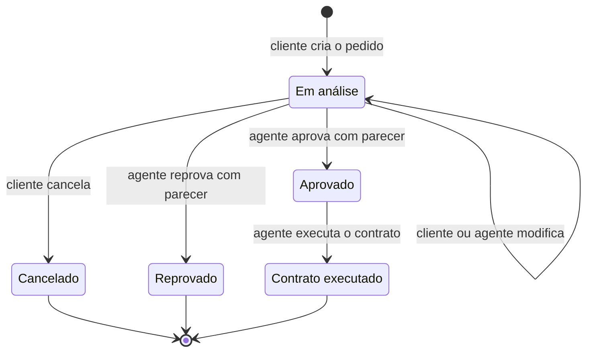

# Histórias de Usuário

Sistema de aluguel de carros - Locadora do Dudu.

Os papéis seguem o enunciado do laboratório: o **cliente** (usuário individual) cria e acompanha pedidos, e o **agente** (empresa ou banco) analisa e modifica esses pedidos.

## Cliente

| ID | História | Critérios de aceitação |
|----|----------|------------------------|
| US01 | Como **visitante**, quero me cadastrar como cliente para poder usar o sistema. | O cadastro pede nome, e-mail, senha (mínimo de 6 caracteres), RG, CPF, endereço e profissão. O CPF é validado pelos dígitos verificadores. O e-mail não pode repetir. Depois de cadastrado, o cliente já entra logado. |
| US02 | Como **cliente**, quero informar de 0 a 3 empregadores com o rendimento de cada um para que o agente possa avaliar minha renda. | A tela permite adicionar até 3 linhas de empregador e rendimento, e remover qualquer uma. Linhas preenchidas pela metade geram erro. |
| US03 | Como **usuário cadastrado**, quero entrar com e-mail e senha para acessar minha área. | E-mail ou senha errados mostram uma mensagem de erro. O cliente vai para a página de frota e o agente para a lista de pedidos. Páginas restritas redirecionam para o login quando não há sessão. |
| US04 | Como **cliente**, quero consultar e alterar meus dados cadastrais para mantê-los corretos. | A tela "Meus dados" carrega o cadastro atual. A senha só muda se um novo valor for informado. |
| US05 | Como **cliente**, quero excluir minha conta para deixar de usar o sistema. | Pede confirmação. A conta e todos os pedidos do cliente são removidos e a sessão termina. |
| US06 | Como **cliente**, quero ver a frota com foto, preço e descrição e filtrar por categoria para escolher um carro. | A frota mostra os carros em cards. Os filtros são Todos, Super esportivo, Cinema e TV e Popular. Cada carro mostra ano, placa e diária. |
| US07 | Como **cliente**, quero criar um pedido de aluguel informando o período para reservar um carro. | Retirada e devolução são obrigatórias, a devolução não pode ser antes da retirada e a retirada não pode ser no passado. O valor estimado (diárias vezes valor da diária) aparece antes de salvar. O pedido nasce com o status "Em análise". |
| US08 | Como **cliente**, quero informar de quem será a propriedade do carro e se há crédito bancário para que o contrato reflita a negociação. | A propriedade pode ser cliente, empresa ou banco. Se houver crédito, é obrigatório escolher o banco que o concede. |
| US09 | Como **cliente**, quero ver o status de cada pedido e o parecer do agente para acompanhar a análise. | A lista mostra número, carro, período, crédito e status. Ao abrir um pedido já analisado, o parecer do agente aparece. |
| US10 | Como **cliente**, quero modificar um pedido que ainda está em análise para corrigir datas, carro, propriedade ou crédito. | Só pedidos "Em análise" podem ser editados. Pedidos em outros status abrem somente para leitura. |
| US11 | Como **cliente**, quero cancelar um pedido em análise para desistir do aluguel. | Pede confirmação. O pedido passa a "Cancelado" e libera o carro no período. |
| US12 | Como **cliente**, quero ser impedido de reservar um carro já ocupado no período para evitar conflito. | Se existir outro pedido ativo (em análise, aprovado ou com contrato executado) do mesmo carro sobrepondo as datas, o sistema recusa e informa o motivo. |

## Agente (empresa ou banco)

| ID | História | Critérios de aceitação |
|----|----------|------------------------|
| US13 | Como **agente**, quero ver todos os pedidos e filtrar por status para organizar minha fila de análise. | A lista mostra cliente, carro, período, crédito e status, com filtro por status. |
| US14 | Como **agente**, quero ver os dados do contratante e a renda total para fazer a análise financeira. | Ao abrir o pedido aparecem nome, RG, CPF, endereço, profissão, cada empregador com rendimento e o total mensal. O valor estimado do aluguel aparece como percentual da renda. |
| US15 | Como **agente**, quero aprovar ou reprovar um pedido com um parecer para dar o resultado da análise financeira. | O parecer é obrigatório para aprovar ou reprovar. O pedido passa a "Aprovado" ou "Reprovado" e o cliente vê o parecer. |
| US16 | Como **agente**, quero modificar dados de um pedido (período, carro, propriedade, crédito) para ajustá-lo durante a análise. | A modificação vale para pedidos "Em análise" e "Aprovado", e respeita a mesma regra de conflito de reservas. |
| US17 | Como **agente**, quero executar o contrato de um pedido aprovado para concluir o aluguel. | O botão "Executar contrato" só aparece para pedidos "Aprovado". O status passa a "Contrato executado". |

## Acesso de demonstração

| ID | História | Critérios de aceitação |
|----|----------|------------------------|
| US18 | Como **avaliador**, quero entrar com uma conta de demonstração sem me cadastrar para testar o sistema rapidamente. | A tela de login tem botões para entrar como cliente, empresa ou banco, usando contas já cadastradas no `db.json`. O cadastro continua disponível. |

## Fluxo de status do pedido

